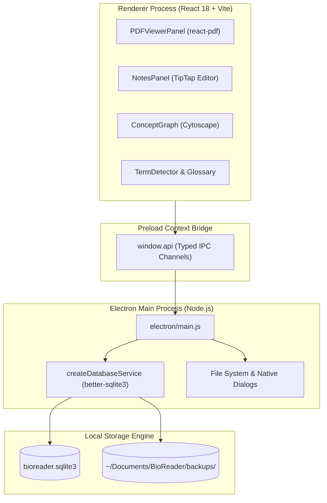

# 📚 BioReader

**Intelligent Scientific PDF Reader & Knowledge Workspace for Bioinformatics and Life Sciences Researchers**

[](https://www.electronjs.org/)
[](https://react.dev/)
[](https://vitejs.dev/)
[](https://github.com/WiseLibs/better-sqlite3)
[](LICENSE)

---

## 🎯 Why I Built This

Existing scientific note-taking tools often feel bloated with steep learning curves and heavy cloud dependencies. As a researcher, I recall papers through visual and spatial memory: remembering where key paragraphs, equations, and figures sit across columns and pages. 

BioReader was built to provide a clean, local-first scientific workspace tailored to how the human brain actually processes complex literature. It eliminates cognitive friction by combining lightning-fast PDF rendering, structured semantic notes, automatic term detection, and instant exports.

---

## ✨ Core Features

* **Visual-Spatial Reading:** High-fidelity PDF rendering with dual-page/single-page modes, zoom snapping, and layout persistence.
* **Structured Annotation System:** Categorize thoughts into semantic types (Quick Note, Deep Note, Question, Critique, Insight) with custom highlight palettes.
* **Inline Math & Equations:** Native KaTeX rendering for complex mathematical and statistical formulas directly inside your notes.
* **Concept Mapping:** Interactive Cytoscape graph visualization to explore relationships between topics, genes, and literature notes.
* **Built-in Biological Glossary:** Offline search across 2,000+ curated biological and bioinformatics definitions with instant term detection.
* **Multi-Format Export Engine:** One-click export to Obsidian-ready Markdown, BibTeX citation files, Anki flashcard decks, and Word documents (.docx).
* **Local-First & Private:** All data resides in a local SQLite database (`~/Documents/BioReader/bioreader.sqlite3`) with automated periodic backups. Zero cloud telemetry.

---

## 🏗️ Architecture



---

## ⌨️ Keyboard Shortcuts

| Shortcut | Action |
|---|---|
| `CmdOrCtrl + O` | Open PDF Document |
| `CmdOrCtrl + N` | Quick Note |
| `CmdOrCtrl + Shift + N` | Deep Research Note |
| `CmdOrCtrl + Q` | Question Note |
| `CmdOrCtrl + C` | Critique Note |
| `CmdOrCtrl + I` | Insight Note |
| `CmdOrCtrl + D` | Dictionary Lookup |
| `CmdOrCtrl + K` | Global Glossary Search |
| `CmdOrCtrl + F` | Search within PDF |
| `CmdOrCtrl + H` | Toggle Highlights |
| `CmdOrCtrl + S` | Export Notes (Markdown/BibTeX/Anki) |
| `CmdOrCtrl + /` | Keyboard Shortcuts Cheat Sheet |

---

## 🚀 Getting Started

### Prerequisites

* Node.js 20+ or 22+
* npm 10+

### Installation

```bash
# Clone the repository
git clone https://github.com/BurakBulut-sh/BioReader.git
cd BioReader

# Install dependencies
npm install

# Rebuild native modules for Electron
npx @electron/rebuild
```

### Running in Development

```bash
# Start both Vite dev server and Electron app
npm run dev
```

### Running Tests and Linting

```bash
# Run unit tests
npm test

# Run ESLint
npm run lint

# Build frontend assets
npm run build
```

### Packaging Desktop Binary

```bash
# Build desktop executable for macOS
npm run package:mac
```

---

## 📄 License

This project is licensed under the MIT License. See [LICENSE](LICENSE) for details.
